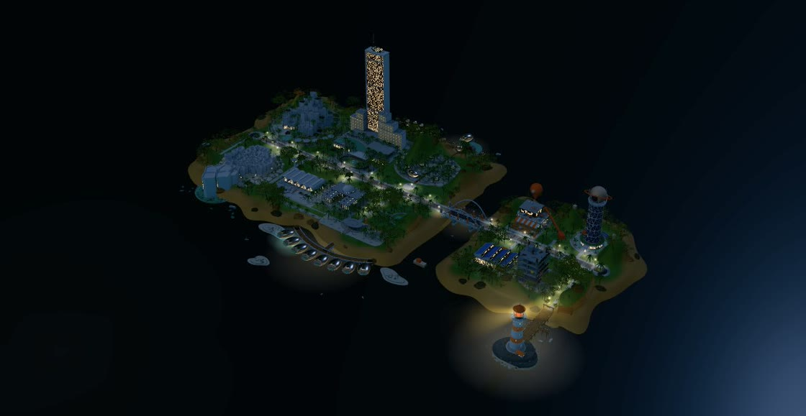

# Charles John Silva

**AI Automation Engineer · Software Developer**

Metro Manila, Philippines · Working with teams worldwide

[Explore the portfolio](https://charlesjohnsilva.com/) · [LinkedIn](https://www.linkedin.com/in/charlesjohnsilva/) · [Get in touch](https://charlesjohnsilva.com/#contact)

## AI Automation Engineering

Builds AI-assisted workflows around the tools a team already uses. Each project starts with a review of how the work gets done, where it slows down, and what a good outcome looks like. Review steps and handoffs stay part of the workflow.

## Software Development

Builds web, mobile, and desktop software around clear requirements and the way people will use it. Architecture and construction are part of the background, with software work spanning other industries and use cases.

## Selected projects

| Project | What it explores |
| --- | --- |
| **Salikmata AI** | A Mac assistant in development for planning, building, and reviewing work, with local project memory. |
| **Tuklas** | An iPhone-first app in development for discovering cafés and meeting people. |
| **Interactive portfolio** | A Three.js tour across two modeled islands, with project cards and an interactive drawing viewer. |

[See project details in the portfolio](https://charlesjohnsilva.com/#software)

**Off the clock** · Anime, worldbuilding, and the kind of background art that makes a place feel lived in.
