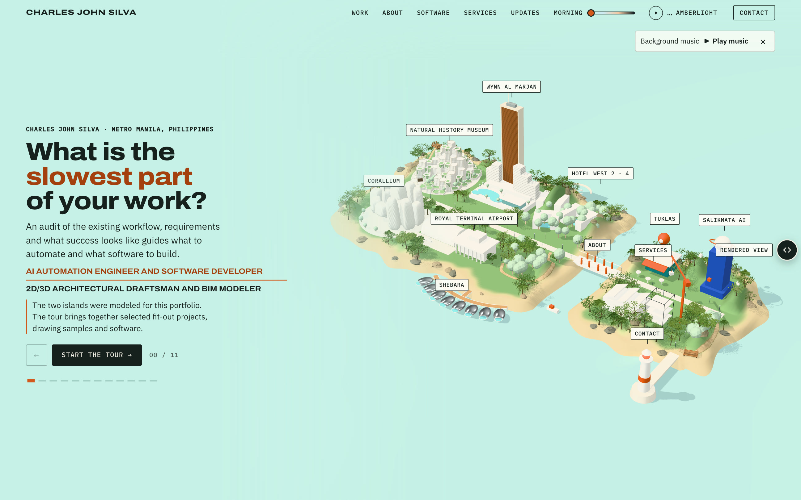

# Charles John Silva

**AI Automation Engineer · Software Developer**

Metro Manila, Philippines · Working with teams worldwide

Professional background in architectural drafting, BIM coordination, and interior fit-out, including site work in the UAE and Bahrain. Current work spans AI automation and the development of web, mobile, and desktop applications.

## Portfolio

Selected fit-out projects from more than eight years in construction, with architectural drafting, BIM coordination, and shop drawings that support fabrication and installation.

Portfolio time-of-day preview

<a href="https://charlesjohnsilva.com/">
  <picture>
    <source media="(prefers-reduced-motion: reduce)" srcset="assets/portfolio-landing-2592.jpg">
    <source media="(max-width: 640px)" type="image/webp" srcset="assets/portfolio-time-of-day-1280.webp">
    <source type="image/webp" srcset="assets/portfolio-time-of-day-2592.webp">
    
  </picture>
</a>

[Explore the interactive portfolio](https://charlesjohnsilva.com/) · [Watch the 4K tour with music](https://github.com/caleb0000-dev/caleb0000-dev/blob/main/walkthrough.md)

## AI Automation Engineering

AI-assisted workflows for repetitive work across the tools a team already uses. Each workflow keeps a clear review step wherever a person needs to check the output or make a decision.

## Software Development

Web, mobile, and desktop applications shaped by what people need to get done. Requirements and examples from the team’s day-to-day work guide what to build and how to test it.

### Software projects in development

- **Salikmata AI** is a Mac workspace for planning, building, and reviewing work, with project context stored locally.
- **Tuklas** is an iPhone-first app for finding cafés and meeting people who want to explore them.

Salikmata startup animation

<picture>
  <source media="(prefers-reduced-motion: no-preference)" srcset="assets/salikmata-startup-loop.svg">
  
</picture>

[See the software projects](https://charlesjohnsilva.com/#software) · [LinkedIn](https://www.linkedin.com/in/charlesjohnsilva/) · [Get in touch](https://charlesjohnsilva.com/#contact)
